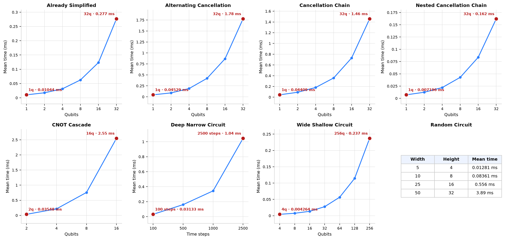

# QCTidy Benchmarks

This branch (`benchmarks`) contains detailed benchmark execution results for QCTidy.
Please note that the results were manually added here, there is no automated system yet for adding commits to this branch.

## Summary



Compact overview of the mean execution time per benchmark. Every chart uses a linear scale, and its first and last points are highlighted; `Random Circuit` is shown as a table because it varies two parameters.

To regenerate the summary from the results in [`criterion/`](#criterion):

```bash
uv run python plot_benchmarks.py
```

This requires [uv](https://docs.astral.sh/uv/); it creates the environment from `pyproject.toml` and `uv.lock`.

## Contents

- [`benchmarks_summary.png`](#summary) — compact visual summary of the results.
- [`plot_benchmarks.py`](#summary) — script that regenerates the summary from `criterion/`.
- [`system_info.json`](#system_infojson) — specifications of the machine that produced the results.
- [`criterion/`](#criterion) — the reports generated by [Criterion.rs](https://github.com/criterion-rs/criterion.rs).

## system_info.json

The machine used to run the benchmarks, captured before the run. Benchmark numbers are only meaningful together with this context.

| Field               | Meaning                                           |
| ------------------- | ------------------------------------------------- |
| `os`                | Full OS description.                              |
| `os_name`           | OS name.                                          |
| `os_version`        | OS version.                                       |
| `kernel`            | Kernel version.                                   |
| `hostname`          | Machine hostname.                                 |
| `architecture`      | CPU architecture (e.g. `x86_64`).                 |
| `rustc`             | Rust compiler version used to run the benchmarks. |
| `cpu_vendor`        | CPU vendor.                                       |
| `cpu_brand`         | CPU model.                                        |
| `cpu_frequency_mhz` | CPU frequency in MHz.                             |
| `physical_cores`    | Number of physical CPU cores.                     |
| `logical_cores`     | Number of logical CPU cores (hardware threads).   |
| `total_memory_gib`  | Total RAM in GiB.                                 |
| `total_swap_gib`    | Total swap space in GiB.                          |

## criterion

These are Criterion execution results: the folder is a copy of Criterion's default output directory (`target/criterion/`) and uses exactly the same layout and file format that Criterion produces by default.

Criterion writes one folder per benchmark group, and inside it one folder per benchmark parameter:

```plain
criterion/
└── <group>/
    ├── report/              # group summary report
    └── <parameter>/
        ├── new/             # raw measurements from the run
        └── report/          # report for this single benchmark
```

To browse the results, open the HTML report index in your browser: `criterion/report/index.html`.
It contains a summary of every benchmark group execution result, with links to each benchmark.

### Benchmark groups

| Group                       | Parameter      | Values                     | Description                                                                   |
| --------------------------- | -------------- | -------------------------- | ----------------------------------------------------------------------------- |
| `Already Simplified`        | Qubits         | 1, 2, 4, 8, 16, 32         | Large circuit with no obvious simplification opportunities (repeating H/T/S). |
| `Alternating Cancellation`  | Qubits         | 1, 2, 4, 8, 16, 32         | Rows of alternating H, X, Y and Z gates that cancel out.                      |
| `Cancellation Chain`        | Qubits         | 1, 2, 4, 8, 16, 32         | Long rows of repeated H gates that cancel out.                                |
| `Nested Cancellation Chain` | Qubits         | 1, 2, 4, 8, 16, 32         | Symmetric H/X/Y/Z chains that cancel one gate pair at a time.                 |
| `CNOT Cascade`              | Qubits         | 2, 4, 8, 16                | Reducible cascades of CNOT (CX) gates.                                        |
| `Deep Narrow Circuit`       | Time steps     | 100, 500, 1000, 2500       | Few qubits with increasing circuit depth.                                     |
| `Wide Shallow Circuit`      | Qubits         | 4, 8, 16, 32, 64, 128, 256 | Increasing number of qubits at constant depth.                                |
| `Random Circuit`            | Width x height | 5x4, 10x8, 25x16, 50x32    | Random (seeded) gates over varying widths and heights.                        |

The HTML reports include the mean/median/std-dev/MAD statistics and the distribution, regression and iteration-time plots.

## Results summary

Mean execution time for every benchmark case, measured with Criterion on the machine described in [`system_info.json`](#system_infojson). Times are in milliseconds, rounded to three significant figures; open [`criterion/`](#criterion) for the full reports.

| Benchmark                 | Parameter      | Value | Mean execution time (ms) |
| ------------------------- | -------------- | ----- | ------------------------ |
| Already Simplified        | Qubits         | 1     | 0.0104                   |
|                           |                | 2     | 0.0176                   |
|                           |                | 4     | 0.0316                   |
|                           |                | 8     | 0.0627                   |
|                           |                | 16    | 0.124                    |
|                           |                | 32    | 0.277                    |
| Alternating Cancellation  | Qubits         | 1     | 0.0453                   |
|                           |                | 2     | 0.0893                   |
|                           |                | 4     | 0.189                    |
|                           |                | 8     | 0.422                    |
|                           |                | 16    | 0.868                    |
|                           |                | 32    | 1.78                     |
| Cancellation Chain        | Qubits         | 1     | 0.0441                   |
|                           |                | 2     | 0.092                    |
|                           |                | 4     | 0.181                    |
|                           |                | 8     | 0.358                    |
|                           |                | 16    | 0.731                    |
|                           |                | 32    | 1.46                     |
| Nested Cancellation Chain | Qubits         | 1     | 0.0072                   |
|                           |                | 2     | 0.0124                   |
|                           |                | 4     | 0.022                    |
|                           |                | 8     | 0.0428                   |
|                           |                | 16    | 0.0837                   |
|                           |                | 32    | 0.162                    |
| CNOT Cascade              | Qubits         | 2     | 0.0355                   |
|                           |                | 4     | 0.216                    |
|                           |                | 8     | 0.758                    |
|                           |                | 16    | 2.55                     |
| Deep Narrow Circuit       | Time steps     | 100   | 0.0313                   |
|                           |                | 500   | 0.161                    |
|                           |                | 1000  | 0.344                    |
|                           |                | 2500  | 1.04                     |
| Wide Shallow Circuit      | Qubits         | 4     | 0.00426                  |
|                           |                | 8     | 0.00747                  |
|                           |                | 16    | 0.0135                   |
|                           |                | 32    | 0.0277                   |
|                           |                | 64    | 0.0567                   |
|                           |                | 128   | 0.114                    |
|                           |                | 256   | 0.237                    |
| Random Circuit            | Width x height | 5x4   | 0.0128                   |
|                           |                | 10x8  | 0.0836                   |
|                           |                | 25x16 | 0.556                    |
|                           |                | 50x32 | 3.89                     |
